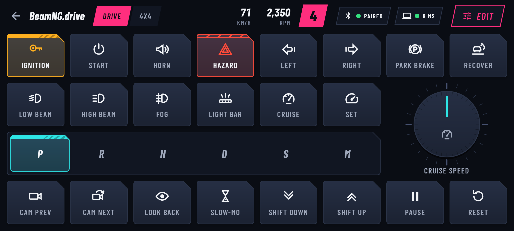
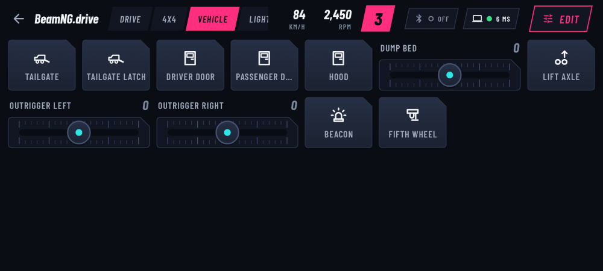
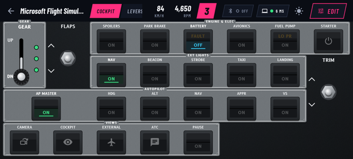
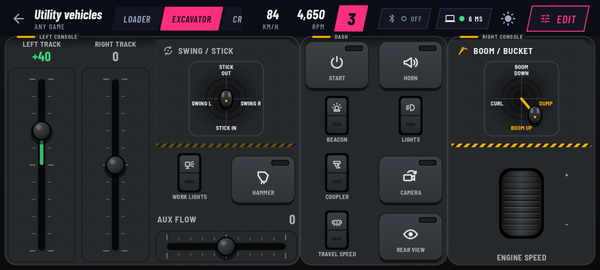

# SimDeck: an Android control surface for Windows games

**Version 1.2.0.** Turn an Android phone or tablet into an extra controller for any Windows game: buttons, toggles,
switches, sliders, pilot joysticks, rotaries and indicator lamps beyond your gamepad, organised in per-game profiles.
BeamNG.drive is fully supported both ways (live vehicle state on the phone, game commands, in-game auto-binding, and a
Vehicle page that fills itself with the functions of the vehicle you drive), and there are built-in profiles for a generic
gamepad, keyboard keys, MudRunner, SnowRunner, Expeditions, Euro Truck Simulator 2, American Truck Simulator, Farming
Simulator 25, Assetto Corsa Competizione, Microsoft Flight Simulator, a bulldozer and other utility vehicles. The phone
can switch to the right profile by itself when a game comes to the front on the PC. Equipment themes make each profile look
and feel like what you drive: an airliner flight deck, a machine cab, a truck dash, a race car (see [docs/THEMES.md](docs/THEMES.md)).

## Download

Get the latest release from **https://github.com/alialyami90/GameControl/releases**: `SimDeck.apk` (phone),
`SimDeck-companion-win-x64.zip` (PC companion), `simdeck.zip` (BeamNG mod). Then follow
[docs/INSTALL.md](docs/INSTALL.md).

**Requirements:** Android 9 or newer; Windows 10 or 11, 64-bit (the companion is self-contained, no .NET install needed);
Bluetooth on the PC for the Bluetooth route; the same Wi-Fi network for the companion route.

## What's in this repository

| Part | Folder | What it does |
|---|---|---|
| Android app | `android/` | Profiles, layout editor, play surface. Acts as a **Bluetooth HID controller** ("SimDeck Pad": keyboard + 64-button / 8-axis gamepad) and/or talks to the companion over Wi-Fi. |
| Windows companion | `windows/` | Optional tray app: scancode keyboard, vJoy, virtual Xbox pad (ViGEm), macros, BeamNG commands and game feedback to the phone. |
| BeamNG mod | `beamng-mod/` | Reports vehicle state, runs commands, writes in-game bindings. |
| Protocol | `protocol/PROTOCOL.md` | The shared, versioned phone / PC / mod protocol. |

Install and usage: [docs/INSTALL.md](docs/INSTALL.md). Full end-to-end check: [docs/SMOKE_TEST.md](docs/SMOKE_TEST.md). Taking over development: [docs/HANDOVER.md](docs/HANDOVER.md).
What changed: [docs/RELEASE_NOTES.md](docs/RELEASE_NOTES.md). What's planned: [docs/ROADMAP.md](docs/ROADMAP.md). Companion build details: `windows/README.md`.

## License

No open-source license has been chosen: all rights are reserved by the project owner (ALI). You may install and use the
released builds; ask before redistributing or reusing the code.
